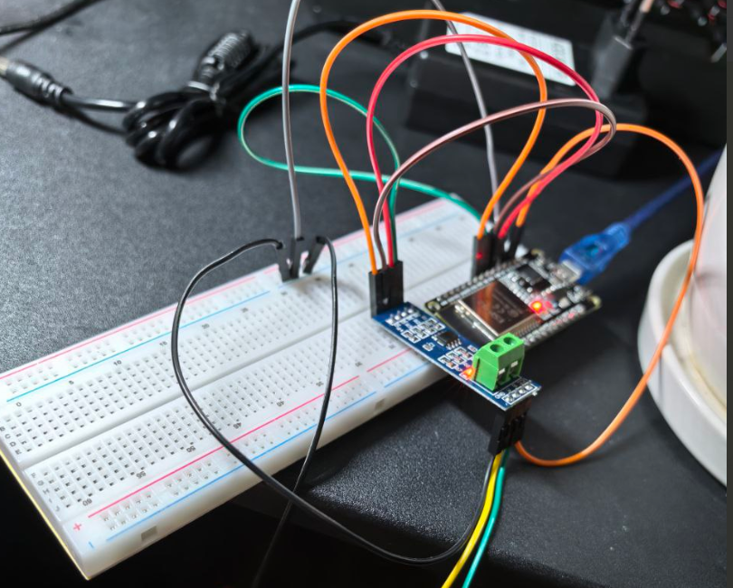

# ESP32 Soil Sensor (Arduino)

ESP32 odczytuje czujnik gleby przez RS485 Modbus i udostępnia dane przez HTTP JSON endpoint `/soil`.

## Podłączenie RS485

## Setup

1. Skopiuj plik:

config.h.example -> config.h

2. Ustaw swoje WiFi i parametry.

3. Otwórz SoilSensor-ESP32.ino w Arduino IDE

4. Wgraj na ESP32

## Endpoint

http://IP/soil

Przykład:

{"ok":true,"temp_c":22.6,"moist_pct":34.5,"ph":7.12}

## Tryby

STA – łączy się z WiFi  
AP – fallback hotspot jeśli WiFi nie działa

